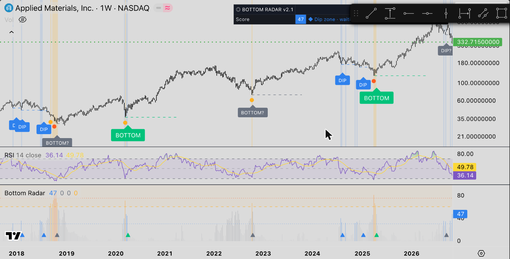
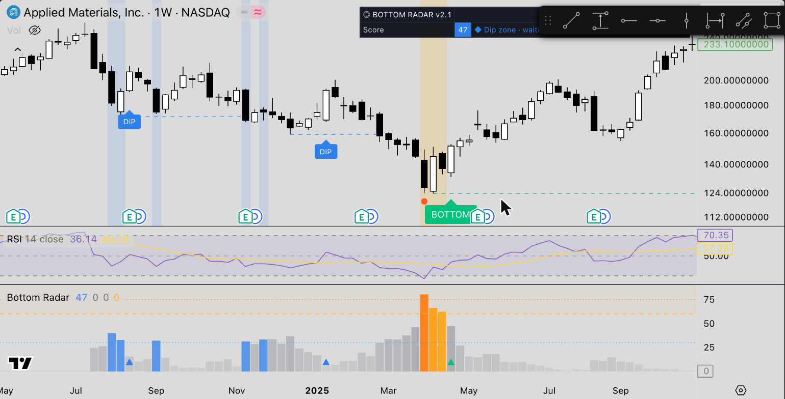
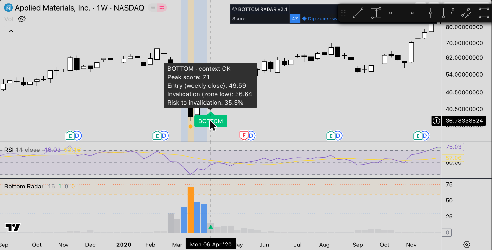
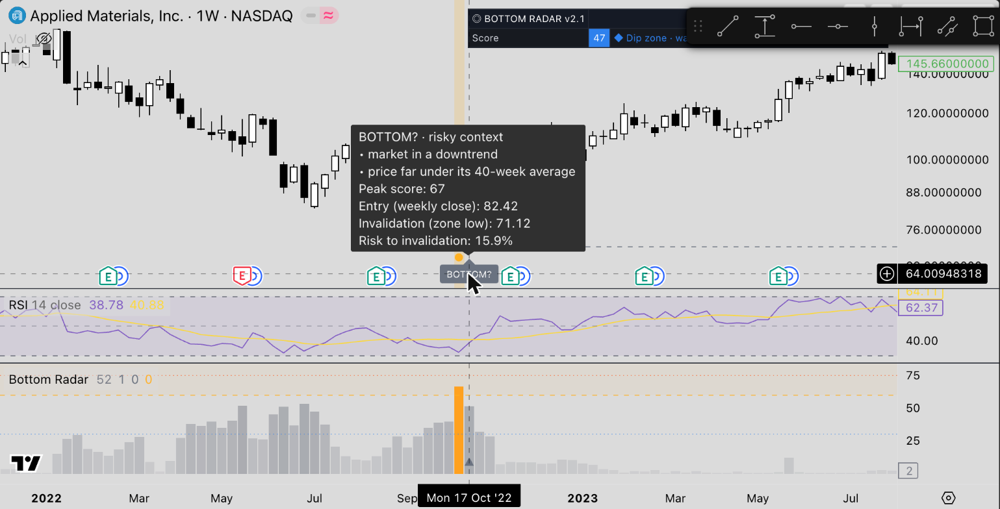
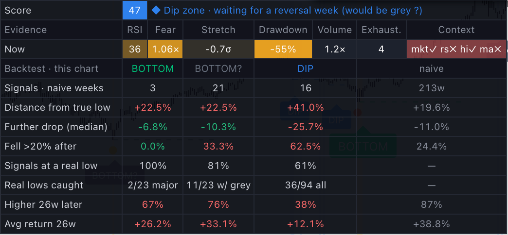
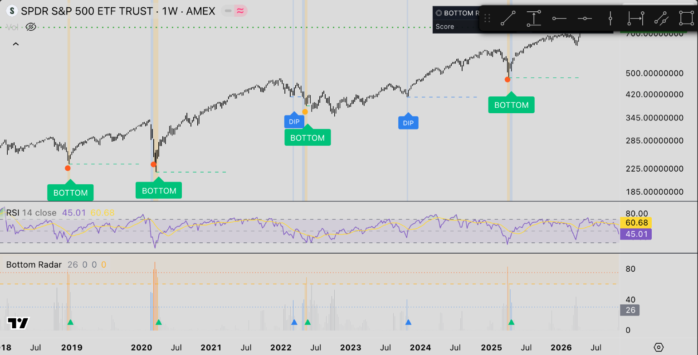

# Bottom Radar TradingView

A weekly-chart TradingView indicator (Pine Script v6, **v2.4**) that spots **capitulation bottoms** and **buy-the-dip lows**. It waits for the price to actually turn up, then **grades each signal** green (good conditions) or grey "?" (risky), based on a backtest of **370+ charts**.

*Every element on one chart (AMAT weekly): blue DIPs, green BOTTOMs at the 2020 and 2025 lows, grey BOTTOM? signals in 2018 and 2022, zone shading, dots, dashed invalidation lines, and the score pane.*

---

## How it works

**In one sentence:** it measures how exhausted the sellers are, waits for the price to turn up, then grades how trustworthy that turn is.

### Step 1 — Measure the selling pressure (0–100 score)
Every week, six signs of capitulation are blended into the score shown in the lower pane:

| Sign | What it measures | Full points when… | Weight |
|---|---|---|---|
| **RSI** | How oversold momentum is | Weekly RSI is down at 25 (no points above 45) | 22 |
| **Fear gauge** | A fear spike measured from price alone (Williams VIX Fix) | This week's low is far below the recent highs, compared with normal | 20 |
| **Stretch** | Distance below the 52-week average | About 2.5 standard deviations below | 14 |
| **Drawdown** | Fall from the 52-week high, scaled to the stock's normal volatility | Bigger than a year's normal swing | 14 |
| **Volume** | Panic selling | 2.5× the 26-week average | 10 |
| **Exhaustion** | How long the decline has run | 9+ weeks in a row closing below the close 4 weeks earlier | 10 |

### Step 2 — Open a zone (early warning)
- **Bottoming zone (amber shading):** the score reaches **60+**. A dot marks the week the zone opens and turns red if the score hits 75+.
- **Dip zone (blue shading):** the score reaches **30+** during a 10%+ pullback in an uptrend, while the stock is still within 35% of its all-time high and near its 40-week average.

### Step 3 — Wait for confirmation (the label prints)
While a zone is active (up to 8 weeks after the last zone week), a label prints on the first week that **closes above the previous week's high**, or on which **RSI rises two weeks in a row with a higher close**. It skips the signal if price has already run more than 4 weekly ranges (ATR) off the low. Signals only print on a **closed weekly bar**, so labels never repaint.

*The full sequence at the April 2025 low. The score jumps past 75 (orange columns), the amber zone opens with a red dot, and the next reversal week prints a green **BOTTOM**. The dashed line marks the zone low, which is the level where the setup fails.*

### Step 4 — Grade it: green vs grey "?"
A **green BOTTOM** needs every check to pass. The table's *Context* cell shows "all ✓" or lists the failing ones (`mkt rs hi ma dd vol`):

| Check | Code | Why (from the backtest) |
|---|---|---|
| Market (SPY) isn't in a downtrend, or SPY just confirmed its own bottom | `mkt` | Most failed bottoms happened while the whole market kept falling (2008: 51 of 68 failed) |
| Stock isn't lagging the market by more than 15% over 13 weeks | `rs` | Stock-specific selling tends to continue |
| 52-week high is within 25% of the all-time high | `hi` | Crashes from near the highs recover; long declines don't |
| Price is within 20% of the 40-week average | `ma` | Signals far below the average kept falling |
| Signal comes within 10 weeks of the zone opening | — | Real capitulation reverses fast |

v2.4 adds three more checks from a 200-chart fine-tuning run (`dd`, `vol`): a green BOTTOM also needs the drop from the 52-week high to be **under 27%**, and every green signal needs the stock's yearly volatility to be **under 40%**, because very volatile stocks showed no reliable edge.

A **green DIP** needs the market and relative-strength checks, a pullback **under 18%**, the price no more than **50% above its 200-week average** (no parabolic stocks) and volatility under 40%. Anything that fails a check prints **grey with "?"**. Hover the label to see which checks failed:

| Green: context OK | Grey: risky context |
|---|---|
|  |  |
| AMAT, April 2020: entry, invalidation level and risk are shown on hover | AMAT, October 2022: graded grey because the market was in a downtrend and price was far under its 40-week average. This one worked out, but signals like it failed about 2× as often |

### The table

- **Top rows:** this week's score, status (here *"Dip zone · waiting for a reversal week (would be grey ?)"*), the six evidence readings shaded by strength, and the context checks.
- **Backtest rows:** every past signal on *this* chart, scored 26 weeks later and compared with **naive dip-buying**, i.e. buying every week the stock was already down that much. Green means the signal beat naive; red means it didn't. If a stock's table is mostly red (like AMAT's DIPs here), trust its signals less.

### It works on ETFs and indices too

*SPY weekly: green BOTTOMs at the December 2018, March 2020 and April 2025 lows, plus DIPs in 2022 and 2023. One green signal (May 2022) came early and the market fell further, which shows signals still fail sometimes.*

---

## Backtest results

The rules were designed on 50 charts, checked on 20 held-back stocks, then tested on **100 new charts** the indicator had never seen. Full details are in [BACKTEST_REPORT.md](BACKTEST_REPORT.md).

| 100 new charts, TradingView re-run | Signals | Fell >20% after the signal | Distance from the true low | Higher 26 weeks later |
|---|---|---|---|---|
| 85 stocks: green **BOTTOM** | 210 | **20%** | **18%** | 69% |
| 85 stocks: grey **BOTTOM?** | 760 | 41% | 26% | 62% |
| 85 stocks: naive dip-buying | 9,203 weeks | 41% | 23% | 61% |
| 15 ETFs: green **BOTTOM** | 89 | **9%** | **14%** | 81% |

**Trade-off:** green signals are rare (about 13% of major lows on stocks; green plus grey together cover about 58%). At deep bear-market bottoms (2009, 2022) the signal still fires on time, but it is usually graded grey.

### v2.4 fine-tuning (323 stocks, 50 ETFs)
| Green signals | v2.3 | v2.4 |
|---|---|---|
| BOTTOM: fell >20% after | 18.9% | **15.5%** |
| DIP: fell >20% after | 21.5% | **14.6%** |
| ETF BOTTOM: fell >20% after | 9.9% | **7.5%** |

Grey signals and naive dip-buying both sit at about 38%. See the [report](BACKTEST_REPORT.md).

## Install
1. In TradingView, open **Pine Editor** → **Create new → Indicator**.
2. Paste the contents of [`bottom_radar.pine`](bottom_radar.pine), then **Save**.
3. Click **Add to chart** and switch the chart to the **weekly (1W)** timeframe.
4. Optional: create an alert on **"BOTTOM confirmed (green)"**. It fires at the weekly close.

To hide the stats table entirely, untick **Show table** (first setting on the Inputs tab). Settings are grouped as **Signal engine**, **Grade**, **Evidence**, **Backtest table** and **Style**. The market index for the context check defaults to `AMEX:SPY`.

## Files
| File | What it is |
|---|---|
| `bottom_radar.pine` | The indicator (v2.4) |
| `versions/bottom_radar_v2.0.pine` | Previous version, before the 100-chart learnings |
| `BACKTEST_REPORT.md` | Every test set, the errors found, what changed, and the results |
| `docs/img/` | Screenshots used in this README |

## Disclaimer
Educational tool, not financial advice. The results are historical tendencies measured on weekly charts. Even green signals fail about 1 time in 6. Always use the invalidation level and your own risk management.

## License
MIT. See [LICENSE](LICENSE).
